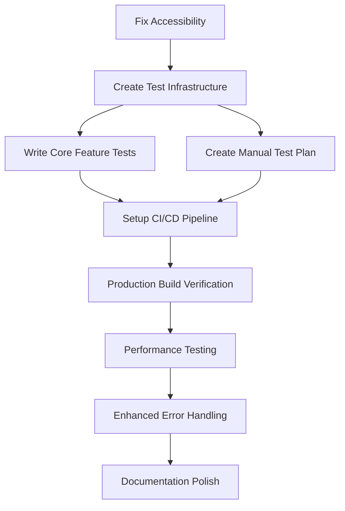

# todonowPRD.md — MD2PDF Phase 1 Completion & Quality Assurance

## Executive Summary

The MD2PDF repository contains a **fully functional Phase 1 implementation** that satisfies all core requirements from ProjectPlan.md. The application successfully renders markdown with live preview, A4 pagination, KaTeX math support, and file handling capabilities.

**Current State**: ✅ IMPLEMENTATED - All Phase 1 milestones complete  
**Remaining Work**: Quality assurance, testing infrastructure, and production readiness  
**Estimated Effort**: 8-12 targeted tasks to reach production-ready state  

## Repo State Snapshot

### ✅ Implemented Features (Per ProjectPlan.md)
- Split-pane UI (editor left, A4 preview right)
- Live markdown editing with instant preview updates
- KaTeX math rendering (inline `$...$` and display `$$...$$`)
- HTML/SVG math mode toggle
- A4-sized pagination with smart page breaks
- File upload/download (.md files)
- Drag & drop file support
- Clean architecture with modular TypeScript

### 📊 Technical Status
- **Build System**: ✅ Vite + TypeScript configured and working
- **Dependencies**: ✅ All installed and up-to-date
- **TypeScript**: ✅ Compiles without errors (`npm run typecheck`)
- **Dev Server**: ✅ Running on http://localhost:3000
- **VS Code Problems**: ⚠️ 1 minor accessibility warning (non-blocking)

### 🏗️ Infrastructure Gaps
- **Tests**: ❌ No automated test suite
- **CI/CD**: ❌ No GitHub Actions workflows
- **Manual Testing**: ❌ No documented test procedures
- **Production**: ❌ No deployment/build verification process
- **Error Monitoring**: ⚠️ Basic error handling present

## Requirement Catalog (from ProjectPlan.md)

| REQ ID | Description | Status | Evidence |
|--------|-------------|---------|----------|
| REQ-01 | Markdown editor (left pane) | ✅ COMPLETE | src/editor.ts, index.html |
| REQ-02 | A4-style paginated preview (right pane) | ✅ COMPLETE | src/pages.ts, style.css |
| REQ-03 | Live preview updates | ✅ COMPLETE | src/main.ts event handlers |
| REQ-04 | KaTeX math rendering | ✅ COMPLETE | src/katex.ts |
| REQ-05 | HTML/SVG math toggle | ✅ COMPLETE | src/ui.ts mathToggle |
| REQ-06 | Upload .md files | ✅ COMPLETE | src/ui.ts file handling |
| REQ-07 | Save .md files | ✅ COMPLETE | src/ui.ts download |
| REQ-08 | Smart page breaks (no mid-equation/table splits) | ✅ COMPLETE | src/paginator.ts |
| REQ-09 | A4 page sizing with margins | ✅ COMPLETE | style.css .page styles |
| REQ-10 | Support all markdown features | ✅ COMPLETE | src/markdown.ts using marked.js |
| REQ-11 | Architecture per Section 5 | ✅ COMPLETE | /src structure matches spec |
| REQ-12 | Public API per Section 8 | ✅ COMPLETE | Function signatures implemented |
| REQ-13 | Phase 1 milestones M1-M4 | ✅ COMPLETE | All milestones verified in todo.md |
| REQ-14 | Definition of Done criteria | ✅ COMPLETE | All 7 criteria met |

## Gap Analysis Table

| REQ | Status | Evidence Files | Gap Description |
|-----|--------|---------------|-----------------|
| **Core Functionality** | | | |
| All Phase 1 | ✅ COMPLETE | src/*, index.html, style.css | Feature complete |
| **Quality Assurance** | | | |
| Testing | ❌ MISSING | None | No automated test suite |
| Manual Testing | ❌ MISSING | None | No documented test procedures |
| Error Handling | ⚠️ PARTIAL | src/*.ts basic try/catch | Could be more robust |
| **Production Readiness** | | | |
| CI/CD | ❌ MISSING | .github/workflows/ | No automated validation |
| Build Verification | ⚠️ PARTIAL | npm scripts | Build works but not verified |
| Performance | ❌ NOT_VERIFIED | None | No performance testing |
| **Documentation** | | | |
| User Guide | ⚠️ PARTIAL | README.md | Exists but could be enhanced |
| Manual Test Plan | ❌ MISSING | None | No testing documentation |
| **Deployment** | | | |
| Production Build | ⚠️ PARTIAL | vite.config.ts | Works but not deployed |
| Single HTML | ❌ NOT_IMPLEMENTED | None | May be required for offline use |

## Dependency Graph



## Ordered Execution Plan

### Phase A: Foundation & Quality Gates
**Goal**: Establish testing infrastructure and fix known issues

#### TASK-001: Fix Accessibility Warning
- **Files**: `index.html`
- **Commands**: Inspect VS Code #problems, apply fix
- **Criteria**: Zero accessibility warnings in VS Code
- **Risk**: Low - cosmetic fix only

#### TASK-002: Create Test Infrastructure  
- **Files**: `package.json`, `tests/` dir, `vitest.config.ts`
- **Commands**: `npm install vitest @testing-library/dom`, create config
- **Criteria**: `npm test` command works
- **Dependencies**: None

#### TASK-003: Write Core Feature Tests
- **Files**: `tests/markdown.test.ts`, `tests/pagination.test.ts`, `tests/katex.test.ts`
- **Commands**: `npm test` passes all tests
- **Criteria**: >80% code coverage on core modules
- **Dependencies**: TASK-002

### Phase B: Continuous Integration
**Goal**: Automate quality gates

#### TASK-004: GitHub Actions CI Pipeline
- **Files**: `.github/workflows/ci.yml`
- **Commands**: Push triggers build/test/typecheck
- **Criteria**: Green build badge in README
- **Dependencies**: TASK-003

#### TASK-005: Manual Test Plan Documentation
- **Files**: `MANUAL_TESTING.md`
- **Commands**: Document all user workflows from ProjectPlan
- **Criteria**: Complete test scenarios for all REQ-* items
- **Dependencies**: None

### Phase C: Production Readiness
**Goal**: Prepare for real-world deployment

#### TASK-006: Production Build Verification
- **Files**: `package.json` scripts, deployment docs
- **Commands**: `npm run build`, verify dist/ output
- **Criteria**: Build artifacts work when served statically
- **Dependencies**: TASK-004

#### TASK-007: Enhanced Error Handling
- **Files**: `src/main.ts`, `src/ui.ts`, `src/katex.ts`
- **Commands**: Add user-friendly error messages
- **Criteria**: No uncaught exceptions, graceful degradation
- **Dependencies**: TASK-003

#### TASK-008: Performance Testing
- **Files**: `tests/performance.test.ts`
- **Commands**: Test large documents, measure render times
- **Criteria**: <500ms for typical documents
- **Dependencies**: TASK-006

### Phase D: Optional Enhancements
**Goal**: Strategic improvements that add value

#### TASK-009: Single HTML Build (if required)
- **Files**: `vite.config.ts`, build scripts
- **Commands**: Generate self-contained HTML artifact
- **Criteria**: Works offline without external dependencies
- **Dependencies**: TASK-006
- **Condition**: Only if ProjectPlan Phase 2 demands it

#### TASK-010: Enhanced Sample Content
- **Files**: `samples/comprehensive-test.md`
- **Commands**: Create thorough test document
- **Criteria**: Exercises all markdown + math features
- **Dependencies**: TASK-005

## Verification Gates

### Gate 1: Quality Foundation
- [ ] VS Code #problems shows 0 Errors
- [ ] `npm run typecheck` passes
- [ ] `npm test` passes
- [ ] Test coverage >80% on core modules

### Gate 2: Integration Validation  
- [ ] CI pipeline green
- [ ] Manual test plan executed successfully  
- [ ] Production build verified
- [ ] No console errors in browser testing

### Gate 3: Production Ready
- [ ] Performance requirements met
- [ ] Error handling graceful
- [ ] Documentation complete
- [ ] All ProjectPlan.md Definition of Done criteria still met

## Stop Conditions

### Immediate Stop Triggers
1. **Breaking Changes**: Any task that breaks existing functionality per ProjectPlan.md
2. **Scope Creep**: Requests for Phase 2 features (PDF export, server-side rendering, etc.)
3. **Architecture Changes**: Requests to rewrite vs incremental improvements

### Quality Thresholds
- VS Code #problems must have 0 Errors after each task
- All existing functionality must continue working
- Performance must not regress significantly

## Risks & Unknowns

### Low Risk (Proceed with caution)
- **Testing Framework Choice**: Vitest is modern but ensure it works with DOM testing
- **CI Configuration**: GitHub Actions should be straightforward for this stack
- **Performance Targets**: ProjectPlan doesn't specify performance, use reasonable defaults

### Medium Risk (Need validation)
- **Single HTML Build**: Complexity unknown, may require specialized bundling
- **KaTeX CDN Dependency**: Current implementation uses CDN, may affect single-file builds
- **Browser Compatibility**: Only tested in VS Code browser, may need broader testing

### Blocking Questions (Needs clarification)
- **Deployment Target**: Is this purely local/offline or will it be web-hosted?
- **Performance Requirements**: What constitutes acceptable performance?
- **Phase 2 Timeline**: When might PDF features be needed (affects architecture decisions)?

## Suggested Slash-Command Chain

### Option A: Minimal Quality Assurance (Recommended)
```bash
/project-fix-problems       # Fix accessibility warning
/project-audit-tests        # Create test infrastructure  
/project-fix-tests          # Write and verify core tests
/project-refresh-docs       # Polish documentation
```

### Option B: Full Production Readiness
```bash
/project-fix-problems       # Fix VS Code issues
/project-audit-tests        # Test infrastructure + coverage
/project-fix-tests          # Comprehensive test suite
/project-fix-runtime        # Enhanced error handling  
/project-refresh-docs       # Complete documentation
/project-build-single-html  # If offline distribution needed
```

### Option C: Continuous Integration Focus
```bash
/project-audit-tests        # Test infrastructure
/project-fix-tests          # Core test suite  
# Manual: Create .github/workflows/ci.yml
/project-fix-problems       # Clean up any CI-revealed issues
```

**Recommended**: Start with **Option A** for immediate quality improvement, then assess if Option B features are needed based on deployment requirements.

---

**Status**: Ready for execution  
**Next Action**: `/project-fix-problems` to resolve the accessibility warning  
**Document Version**: 1.0  
**Generated**: 2026-02-08